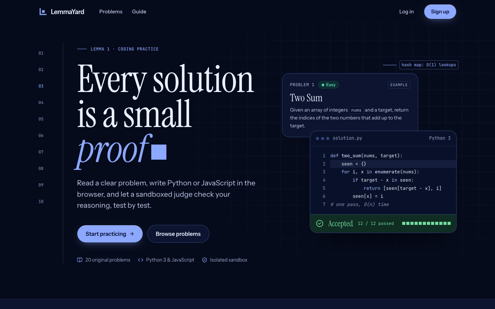
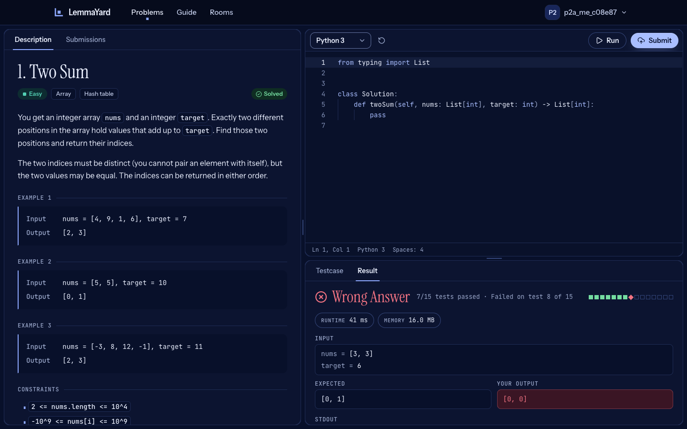
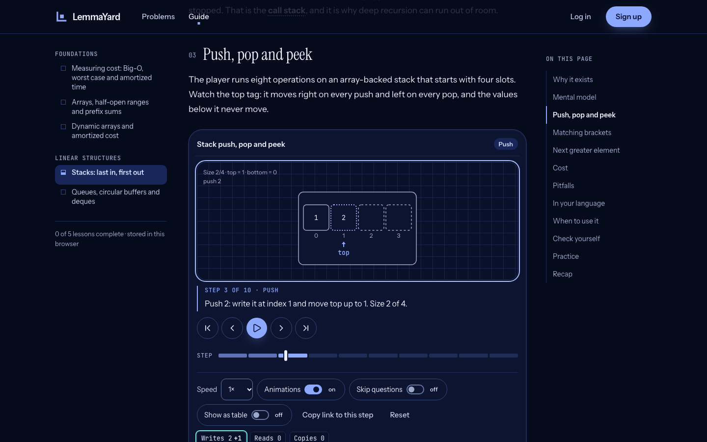
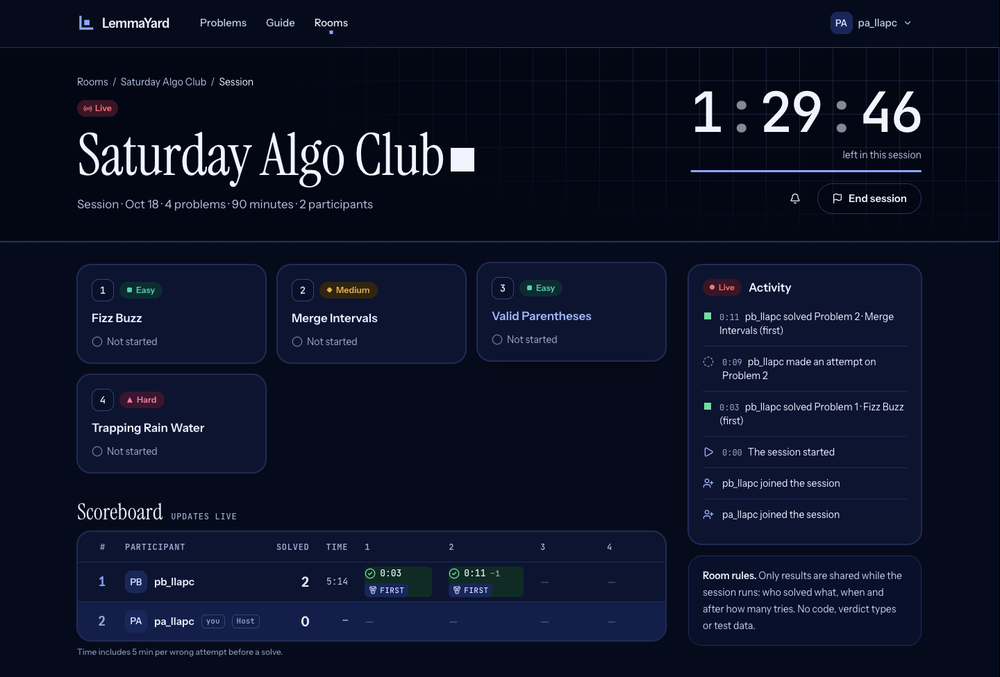
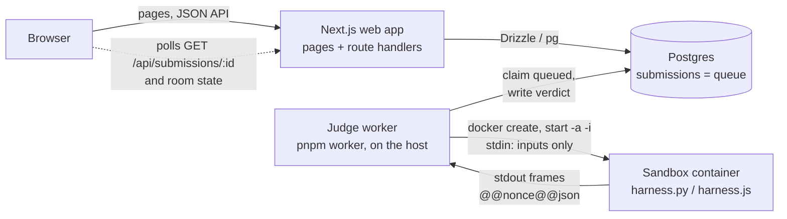

# LemmaYard

LemmaYard is a coding-practice platform for algorithms and data structures.
You read an original problem, write Python or JavaScript in an in-browser
editor and a sandboxed judge checks it test by test. Friends can solve timed
sets of problems together in private rooms, and a data-structures guide
explains each structure with step-by-step interactive visualizations. It is a
Next.js app with Postgres and a small judge worker that runs every submission
in a locked-down Docker container.



## What you can do

- **Solve problems.** 50 original problems (22 easy, 17 medium, 11 hard) with
  search, difficulty/tag/status filters and acceptance rates.
- **Write and run code** in Monaco (bundled locally, no CDN) in Python 3 or
  JavaScript (Node 22). Run checks the sample tests or your own input; Submit
  runs every test and stops at the first failure.
- **Get exact verdicts:** Accepted, Wrong Answer (with input, expected and
  your output), Time Limit, Memory Limit, Runtime Error, Compile Error.
- **Track progress:** submission history with the code of every submit, and a
  public profile (`/u/<username>`) with solved problems by difficulty.
- **Practise with friends** in private rooms: invite links, timed sessions with
  a drawn set of problems, a live person × problem scoreboard (solve times,
  splits, "Judging…" while a submit runs), an activity feed, results with a
  timeline, shared solutions and per-member stats.
- **Learn data structures** in the guide (`/learn`): 5 published lessons
  (complexity basics, arrays, dynamic arrays, stacks, queues and deques) with
  a trace player that steps through each operation next to the Python and
  JavaScript code, prediction questions, quizzes and a glossary.
- **Security basics:** argon2id passwords, same-origin checks, login and
  register rate limits, a strict CSP and other security headers, row level
  security on every table. See [Security](#security).

| Problem workspace | Guide lesson with the trace player |
| --- | --- |
|  |  |



## Contents

- [Quick start](#quick-start)
- [Architecture](#architecture)
- [Scripts](#scripts)
- [Configuration](#configuration)
- [How to add a problem](#how-to-add-a-problem)
- [How to add a language](#how-to-add-a-language)
- [Testing](#testing)
- [Security](#security)
- [Deployment](#deployment)
- [Accepted MVP properties and known limitations](#accepted-mvp-properties-and-known-limitations)
- [Naming, status and license](#naming-status-and-license)

## Quick start

Prerequisites:

- Node.js 22 or newer
- pnpm, the version pinned in `package.json` (`packageManager`); `corepack enable` picks it up
- Docker (Docker Desktop or compatible), for Postgres and the judge sandbox
- `python3` 3.10 or newer on the host, only for `pnpm test` (the guide's code samples are checked on the host)

From a clean clone:

```bash
cp .env.example .env          # works as is locally; for a real secret: openssl rand -base64 32
pnpm install
docker compose up -d --wait   # Postgres 16 on localhost:5433
pnpm sandbox:build            # builds the Python and Node sandbox images
pnpm db:seed                  # applies migrations and imports problems/
pnpm dev:all                  # web on http://localhost:3000 + the judge worker
```

Open http://localhost:3000, sign up and solve a problem.

- `pnpm run setup` runs the four middle steps in one go (`pnpm install && docker
  compose up -d --wait && pnpm sandbox:build && pnpm db:seed`). Type `run`: a
  bare `pnpm setup` is pnpm's own built-in command (it sets up pnpm's home
  directory), not this script.
- Ports: the web app uses `PORT` from `.env` (default 3000); Postgres listens
  on host port **5433** (not 5432, to avoid clashing with a local Postgres).
- `pnpm dev:all` = `pnpm dev` + `pnpm worker`. Run them in two terminals if you
  prefer. Without the worker, Run and Submit stay queued and then report that
  the judge is unavailable.
- `pnpm dev`, `pnpm build` and `pnpm start` go through `scripts/next.mjs`,
  which loads `.env` first; variables set in the shell win over `.env`.
- Stop the database with `docker compose down` (add `-v` to delete its data).

## Architecture



**Web app** (`src/app`, `src/server`). Next.js App Router on the Node runtime.
Server components read the database directly; mutating route handlers check
the `Origin` and the JSON body (Zod) first. Auth is a small custom layer:
argon2id hashes, an HS256 JWT in an httpOnly cookie, user re-read on every
request (`src/server/auth/`).

**Queue.** There is no Redis: a Run or Submit inserts a `submissions` row with
`status=queued` and answers `202 {id}`; the browser polls
`GET /api/submissions/:id` once a second. Rate limits and the
active-submission cap are counted in the same transaction as the insert.

**Worker** (`worker/`). A Node process on the host (it needs the Docker CLI,
so it is not part of `docker compose`). `WORKER_CONCURRENCY` slots claim the
oldest queued row with `FOR UPDATE SKIP LOCKED`, run it, and write the result
only while the row is still `running`. A sweep marks stale `running` rows as
`internal_error` (never requeued) and deletes Run rows older than 24 h.

**Sandbox protocol** (`worker/docker-executor.ts`, `worker/protocol.ts`,
`sandbox/harness.{py,js}`):

1. One fresh container per job: `--network none --read-only --cap-drop ALL
   --security-opt no-new-privileges --pids-limit 64 --cpus 1`, memory and swap
   at the problem's limit, user 65534, a 16 MB `noexec` tmpfs at `/tmp`, no
   bind mounts and no environment variables. Docker is driven only through
   `execFile` with argument arrays.
2. The worker writes **one JSON line** to stdin: `{language, code, signature,
   tests: [{input}], timeLimitMs, stopOnError, nonce}`. Expected outputs never
   enter the container.
3. The harness compiles the code in memory, runs each test with a per-test
   timeout and writes frames `@@<nonce>@@<json>` to the real stdout: `test`
   (`index`, `status: ok|error|timeout`, `actual`, `timeMs`, captured
   `stdout`, `memoryKb`), `compile_error`, `fatal` and `done`. User prints are
   captured (64 KB cap); lines without the nonce prefix are ignored.
4. The worker enforces a wall clock (`3 s + min(tests × limit, WALL_CAP_MS)`)
   and a 1 MB output cap, then reads `ExitCode`/`OOMKilled` and removes the
   container.
5. **The verdict is decided on the host** (`worker/judge.ts`): wall clock or
   timeout frame → Time Limit; OOM or Node heap abort → Memory Limit; else the
   frames are compared with the expected values by one TypeScript comparator
   (`exact`, `unordered`, `float` with epsilon). On Submit the worker kills the
   container at the first wrong answer.

Containers carry the labels `lemmayard.sandbox=1` and
`lemmayard.ns=<SANDBOX_NAMESPACE>`; a worker only cleans up leftovers of its
own namespace, so several checkouts can run side by side.

**Rooms** (`src/lib/rooms/`, `src/server/rooms/`, spec
[`docs/specs/rooms.md`](docs/specs/rooms.md)). Domain logic (problem draw,
scoring, invites, session state machine, events) is pure TypeScript with
injected randomness. A session goes lobby → live → finished (or cancelled).
Events are appended to `room_events` under a per-session advisory lock; the
live screen polls `GET /api/rooms/:roomId/sessions/:sessionId/state?after=<cursor>`
(every 3 s; every 1.5 s while the response's `pending` list says a session
submit is queued or running, which the scoreboard shows as "Judging…";
v2 spec [`docs/specs/rooms-v2.md`](docs/specs/rooms-v2.md)).
A Submit counts for a session only with an explicit `roomSessionId`, and it is
scored inside the worker's `finalize()` transaction
(`src/server/rooms/outcome.ts`), so every executor must finalize through it.
Expiry is applied lazily by requests and by the worker's sweep.
Rooms v2 ([`docs/specs/rooms-v2.md`](docs/specs/rooms-v2.md)): every member
has one rating per room (`room_members.rating`, Elo-style, pure core in
`src/lib/rooms/rating.ts`); new sessions pick problems by rating by default
(or by difficulty, or by hand) from the room's default preset. A rated
session updates the room's ratings once, when it is finished and nothing is
still being judged (`src/server/rooms/ratings.ts`).

**Guide** (`src/content/learn/`, `src/lib/guide/`, `src/components/guide/`).
Each lesson is MDX plus metadata, quiz and code samples. A visualization is a
`VizModel` (`src/lib/guide/contracts.ts`) whose pure `generate(input)` returns a
`Trace`: a list of frames with a JSON state, element roles, pointers, the
current code line id, narration and operation counters. The server `<Viz>`
renders the first trace and the Shiki-highlighted Python and JavaScript
listings (lines tagged with `# @line id` / `// @line id` markers); the client
`TracePlayer` steps, plays and scrubs the frames, highlights the matching code
line, asks prediction questions and recomputes the trace for user input. No
user code runs in the guide. Progress stays in the browser's localStorage.

### Repository layout

```
src/app/            routes: (site)/ pages with header + footer, (workspace)/ problem page, api/
src/components/     UI (ui/ = shadcn on Base UI; problem/, rooms/, guide/, ...)
src/lib/            shared code: value types, templates, problem schemas, rooms domain, guide contracts
src/server/         server-only: env.ts (Zod env), db/ (Drizzle schema + client), auth/, submissions/, rooms/
src/content/learn/  guide lessons (MDX, metadata, quizzes, code samples)
worker/             judge worker: queue, loop + drain, Docker and Vercel Sandbox executors, protocol, judge
sandbox/            Dockerfile.python, Dockerfile.node, harness.py, harness.js
problems/<slug>/    problem files (meta.json, description.md, tests.json, solution.py, solution.js)
drizzle/            SQL migrations
scripts/            CLI scripts (migrate, import, verify, sandbox build, SQL export)
tests/              unit/, integration/, e2e/, e2e-judge-off/, e2e-support/, helpers/, fixtures/
docs/               deploy guide, specs, generated Supabase SQL, images
```

## Scripts

| Script | What it does |
| --- | --- |
| `pnpm dev` | Next.js dev server on `PORT` (loads `.env`). |
| `pnpm build` | Production build. |
| `pnpm start` | Serves the production build on `PORT`. |
| `pnpm worker` | Judge worker on the host (needs Docker and the sandbox images). |
| `pnpm dev:all` | `dev` + `worker` together (`concurrently`). |
| `pnpm lint` | ESLint. |
| `pnpm typecheck` | `next typegen` + `tsc --noEmit`. |
| `pnpm test` | Vitest unit tests (`tests/unit`), no database or Docker. |
| `pnpm test:integration` | Vitest integration tests (`tests/integration`): Postgres, and Docker for the sandbox suites. |
| `pnpm test:e2e` | Playwright: builds, starts web + worker against a fresh e2e database, runs `tests/e2e`. |
| `pnpm test:e2e:headed` | The same with visible browsers. |
| `pnpm test:e2e:judge-off` | Playwright suite `tests/e2e-judge-off` with `JUDGE_ENABLED=0` and no worker. |
| `pnpm test:e2e:guide` | Only `tests/e2e/guide`, without the worker. |
| `pnpm db:generate` | drizzle-kit: new migration after editing `src/server/db/schema.ts`. |
| `pnpm db:migrate` | Applies migrations (`DATABASE_URL_DIRECT`, else `DATABASE_URL`). |
| `pnpm db:export-sql` | Regenerates `docs/supabase/schema.sql` from `drizzle/*.sql`. |
| `pnpm problems:export-sql` | Regenerates `docs/supabase/problems.sql` (the problem catalog as one idempotent SQL script) and the same catalog split into `docs/supabase/problems-<n>.sql` parts (each under 800 KB, run in any order) from `problems/`; `--check` exits 1 when any of them is stale. |
| `pnpm db:seed` | `db:migrate` + `problems:import`. |
| `pnpm problems:import` | Validates and upserts `problems/` (`--dir <path>`, `--prune`). |
| `pnpm problems:verify` | Runs every reference solution in the real sandbox; must all be Accepted (`--dir`, `--only <slug>`, `--concurrency <n>`). |
| `pnpm sandbox:build` | Builds and checks both sandbox images; rerun after any change in `sandbox/`. |
| `pnpm run setup` | `install` + `docker compose up -d --wait` + `sandbox:build` + `db:seed`. |

`problems:import` validates every problem first and writes nothing if one is
invalid; then it upserts by slug in one transaction. `--prune` unpublishes
problems that are not in the directory (they keep their `number`). Never
combine `--dir <other>` with `--prune` against your dev database: it would
unpublish the whole catalog.

## Configuration

All variables are listed with comments in [`.env.example`](.env.example) and
validated with Zod in `src/server/env.ts` (`getEnv()` is the only way code reads
them). Invalid values fail with a list of the offending variables. The
production table is in [docs/DEPLOY.md, section 3](docs/DEPLOY.md#3-vercel-environment-variables).

| Variable | Default | Purpose |
| --- | --- | --- |
| `DATABASE_URL` | compose Postgres | App database. |
| `DATABASE_URL_DIRECT` | `DATABASE_URL` | Direct/session connection for migrate and import (Supabase). |
| `AUTH_SECRET` | placeholder | JWT key, at least 32 characters; placeholders are rejected in production. |
| `AUTH_URL` | `http://localhost:3000` | Exact origin the browser uses; mutating requests from another origin get 403. |
| `PORT` | 3000 | Web port for `dev` / `start`. |
| `JUDGE_ENABLED` | on, off on Vercel with `docker` | `0` disables Run, Submit and room session start. |
| `JUDGE_EXECUTOR` | `docker` | `docker` = `pnpm worker`; `vercel-sandbox` = the web app judges in Vercel Sandbox (production). |
| `TEST_DATABASE_URL` | compose Postgres | Server for the integration and e2e databases. |
| `WORKER_CONCURRENCY`, `WORKER_POLL_MS` | 2, 500 | Worker slots and poll interval. |
| `SANDBOX_IMAGE_PYTHON`, `SANDBOX_IMAGE_NODE` | `lemmayard-sandbox-*:latest` | Sandbox image tags. |
| `LANG_TIME_MULT_PY`, `LANG_TIME_MULT_JS` | 2, 1 | Per-language multiplier of a problem's time limit. |
| `RUN_RATE_PER_MIN`, `SUBMIT_RATE_PER_MIN`, `MAX_ACTIVE_PER_USER` | 10, 5, 2 | Per-user judge limits. |

## How to add a problem

A problem is a directory `problems/<slug>/` with five files. Schemas:
`src/lib/problems/schema.ts`. A complete minimal example, `problems/running-sum/`:

`meta.json`

```json
{
  "number": 51,
  "slug": "running-sum",
  "title": "Running Sum",
  "difficulty": "easy",
  "tags": ["array", "prefix-sum"],
  "signature": {
    "name": "runningSum",
    "params": [{ "name": "nums", "type": "int[]" }],
    "returns": "int[]"
  },
  "compare": { "mode": "exact" },
  "limits": { "timeMs": 1000, "memoryMb": 128 }
}
```

`tests.json` (at least 5 tests, at least one `"sample": true`; samples are
shown as examples and used by Run, the rest are hidden):

```json
[
  { "input": { "nums": [1, 2, 3, 4] }, "expected": [1, 3, 6, 10], "sample": true },
  { "input": { "nums": [5] }, "expected": [5], "sample": true },
  { "input": { "nums": [] }, "expected": [] },
  { "input": { "nums": [-1, 1, -1, 1] }, "expected": [-1, 0, -1, 0] },
  { "input": { "nums": [0, 0, 0] }, "expected": [0, 0, 0] },
  { "input": { "nums": [1000000, 1000000] }, "expected": [1000000, 2000000] }
]
```

`description.md` (Markdown, sanitized; no raw HTML; the examples come from the samples):

```markdown
Given an integer array `nums`, return an array of the same length whose
element `i` is the sum of `nums[0]` through `nums[i]`.

## Constraints

- `0 <= nums.length <= 10^4`
- `-10^6 <= nums[i] <= 10^6`
```

`solution.py` (a `Solution` class with the method named in `signature.name`):

```python
from typing import List


class Solution:
    def runningSum(self, nums: List[int]) -> List[int]:
        out, total = [], 0
        for x in nums:
            total += x
            out.append(total)
        return out
```

`solution.js` (a function with that name):

```js
/**
 * @param {number[]} nums
 * @return {number[]}
 */
var runningSum = function (nums) {
  let total = 0;
  return nums.map((x) => (total += x));
};
```

Then:

```bash
pnpm problems:verify --only running-sum   # both reference solutions must be Accepted
pnpm problems:import                      # validate and upsert into DATABASE_URL
```

Rules worth knowing:

- Types: `int` (within ±(2^53 − 1)), `float`, `bool`, `string`, `T[]`, `T[][]`.
  Test `input` keys must equal the parameter names; values must match the types.
- `compare.mode`: `exact`; `unordered` (array return; top-level order ignored);
  `float` (float return; needs `epsilon`).
- `limits` is optional (default 2000 ms, 256 MB); Python gets
  `LANG_TIME_MULT_PY`× the time.
- `rating` is optional: the author's estimate for room selection by rating
  (integer 800–3000; without it easy = 1200, medium = 1600, hard = 2000).
  `problems:verify` warns when it is outside the usual band of the difficulty
  (easy 1000–1450, medium 1450–1850, hard 1850–2400). The import updates only
  the author rating; the drift learned from rated sessions is kept.
- Names must be valid identifiers in both languages and must not be reserved
  words or common builtins (`src/lib/problems/identifiers.ts`).
- `number` and `slug` must be unique. Write your own statement; do not copy
  one from another site (see the authoring policy below).
- Starter code in the editor is generated from `signature`
  (`src/lib/templates`), so there is nothing else to write.

### Test generators

Problems with many tests have a generator `problems/_generators/<slug>.py`
(the importer skips directories starting with `_`). It is seeded and
deterministic: it checks the reference `solution.py` against an independently
written brute force on random small inputs and on every stored test small
enough for it, computes `expected` with the reference and rewrites
`tests.json`. Run it from the repository root, then verify:

```bash
python3 problems/_generators/<slug>.py
pnpm problems:verify --only <slug>
pnpm problems:export-sql
```

Keep inputs small unless a test is about performance: every test is stored in
the database and in `docs/supabase/problems*.sql`, and all outputs of one
submission share the judge's 1 MB output cap.

### Problem authoring policy

Every problem in `problems/` is original work of this project and is released
under the repository license (MIT, see `LICENSE`). Classic algorithmic ideas
are common knowledge, but statements, stories, examples, constraints and test
data are written from scratch: never copy, closely paraphrase or reconstruct a
problem (or its tests) from LeetCode, Codeforces, HackerRank or any other site.
New problems also get their own titles and their own twist rather than being a
recognisable one-to-one clone of a well-known problem.

## How to add a language

Python and JavaScript are the only languages today; this is the contract a new
one has to meet (PLAN.md §5 has the full protocol).

1. **Sandbox image.** Add `sandbox/Dockerfile.<lang>`: a base pinned by tag and
   digest, the runner copied read-only to `/sandbox/harness.<ext>`,
   `USER 65534:65534`, `WORKDIR /tmp`, nothing written at run time (the root
   filesystem is read-only), under 200 MB unpacked. Add it to
   `scripts/sandbox-build.ts`, which checks user, size and the harness path.
2. **Harness.** `/sandbox/harness.<ext>` must:
   - read one JSON line from stdin: `{language, code, signature, tests:
     [{input}], timeLimitMs, stopOnError, nonce}`;
   - compile `code` in memory; on failure write one `compile_error` frame;
   - for each test, deep-copy the input, call the function named
     `signature.name` with the parameters in order, enforce `timeLimitMs`, and
     write a `test` frame `{index, status: "ok"|"error"|"timeout", actual?,
     error?, memory?, timeMs, stdout, memoryKb}`; with `stopOnError`, stop
     after the first `error`/`timeout`;
   - write every frame as `\n@@<nonce>@@<json>\n` to the real stdout, finish
     with `done`, and use `fatal` for a crash outside a test;
   - capture user output (64 KB, then `[truncated]`), keep `error` under 8 KB
     and strip harness/host paths from tracebacks;
   - return JSON values only (reject NaN/Infinity and ints outside
     ±(2^53 − 1)); report peak RSS as `memoryKb`.

   Frames are validated by `frameSchema` in `worker/protocol.ts`; the harness
   never sees expected values and never decides the verdict.
3. **Executor.** In `worker/docker-executor.ts`: the image in
   `DockerExecutorConfig`/`dockerConfigFromEnv`, `imageFor()`,
   `sandboxCommand()` (the runner command), the time multiplier in
   `effectiveTimeLimitMs()` and the image check in `prepareSandbox()`. Add
   `SANDBOX_IMAGE_<LANG>` and `LANG_TIME_MULT_<LANG>` to `src/server/env.ts` and
   `.env.example`. If the runtime has its own out-of-memory signal (like
   Node's heap abort), map it in `worker/judge.ts`.
4. **Language list.** `languageEnum` in `src/server/db/schema.ts` (an additive
   migration: `pnpm db:generate`, then `pnpm db:export-sql`), `LANGUAGES` in
   `src/lib/submission-dto.ts` and the message in
   `src/server/submissions/validate.ts`.
5. **Editor and templates.** A template generator in `src/lib/templates` with
   golden files in `tests/unit/__golden__`; label, Monaco id and file name in
   `src/lib/workspace/languages.ts`; the Monaco language registration in
   `src/components/problem/monaco/setup.ts`; drafts in
   `src/lib/workspace/buffers.ts`; the language's reserved words in
   `src/lib/problems/identifiers.ts`.
6. **Problems.** Add the file to `REQUIRED_FILES` in
   `src/server/problems/importer.ts` and to the language list in
   `scripts/verify-problems.ts`, then write `solution.<ext>` for every problem.
7. **Tests.** Add the language to the `describe.each` lists in
   `tests/integration/sandbox-judge.test.ts` and
   `tests/integration/worker-storage.test.ts` and to
   `tests/unit/templates.test.ts`; run `pnpm sandbox:build`,
   `pnpm test:integration` and `pnpm problems:verify`.

## Testing

| Command | What it covers | Needs | Time (dev laptop) |
| --- | --- | --- | --- |
| `pnpm test` | unit tests: types, templates, comparators, schemas, protocol, rooms domain, guide traces and code samples | Node, `python3` ≥ 3.10 | ~10 s |
| `pnpm test:integration` | API, auth, queue, worker, importer, rooms, RLS; Docker sandbox and security suites | Postgres; Docker + `pnpm sandbox:build` for `sandbox-*`, `worker-*`, `submissions-docker` | ~2 min |
| `pnpm test:e2e` | full browser flows incl. judged ones: sign up → Two Sum in Python and JavaScript → Accepted → profile; Wrong Answer; history; rooms live session; guide; CSP | Postgres, Docker, sandbox images | ~3–3.5 min |
| `pnpm test:e2e:judge-off` | the problem page with `JUDGE_ENABLED=0` | Postgres | ~20 s |
| `pnpm test:e2e:guide` | guide pages without the worker | Postgres | ~2.5 min |
| `pnpm problems:verify` | every reference solution in both languages | Docker + images | ~1 min |

- **Integration tests** create (if missing) and migrate their own database
  `leetcopy_test_<suffix>` on the `TEST_DATABASE_URL` server; the suffix is
  `TEST_DB_SUFFIX` or the checkout's directory name, so worktrees never share
  one. Tables are truncated between tests (`tests/helpers/db.ts`).
- **E2E** (`tests/e2e-support/harness.ts`): drops and recreates
  `leetcopy_e2e_<suffix>`, migrates and imports `problems/`, runs `pnpm build`,
  starts `next start` on `E2E_PORT` (default `PORT` + 1177) and the worker with
  the sandbox namespace `<default>-e2e`, and removes everything afterwards. Your
  dev database is never touched. Logs: `node_modules/.cache/e2e/`. Options:
  `E2E_SKIP_BUILD=1`, `E2E_JUDGE=0`, `E2E_REUSE_SERVER=1`, `E2E_KEEP_DB=1`,
  `E2E_WORKERS`.
- **CI** (`.github/workflows/ci.yml`, on pushes and PRs to `main`): lint,
  typecheck, unit tests and build; integration tests against a Postgres
  service, without the Docker suites. Docker suites, `problems:verify` and
  Playwright run locally for now.

## Security

What exists (details: response headers in
`src/server/http/security-headers.ts`, auth in `src/server/auth/`):

- **Sandbox:** see [Architecture](#architecture); escape and abuse tests in
  `tests/integration/sandbox-security.test.ts` (network, filesystem, fork bomb,
  pids, capabilities, environment).
- **Accounts:** argon2id (19 MiB, 2 iterations), passwords 8–128 characters,
  a dummy hash for unknown emails so timing does not reveal accounts. Session:
  HS256 JWT in the `lemmayard_session` cookie (`HttpOnly`, `SameSite=Lax`,
  `Secure` in production, 7 days), user re-read on every request.
- **Requests:** every mutating route requires `Content-Type: application/json`
  and an `Origin` equal to `AUTH_URL`; `?next=` redirects are sanitized.
- **Limits:** login (10 failed per 15 min per address + email, 30 per address)
  and register (3 per hour per address + email, 5 per address) answer 429
  with `Retry-After`; at most 2 argon2 hashes run at once per process. Run and
  Submit limits are counted in the database.
- **Headers:** an enforced CSP (`default-src 'self'`, `frame-ancestors 'none'`,
  `object-src 'none'`, `script-src 'self' 'unsafe-inline'` because the App
  Router streams inline scripts and there are no nonces yet),
  `X-Content-Type-Options: nosniff`, `X-Frame-Options: DENY`,
  `Referrer-Policy` (`no-referrer` on the invite page), `Permissions-Policy`,
  `Cross-Origin-Opener-Policy`. `tests/e2e/security/csp.spec.ts` fails on any
  CSP violation across the main pages.
- **Data:** SQL only through Drizzle; RLS enabled without policies on all 13
  tables, so Supabase's REST roles see nothing; Markdown is sanitized
  (`rehype-sanitize`, no raw HTML); room invite tokens live in the URL
  fragment and only their sha256 is stored.
- **Logs:** user code, program output and passwords are never logged
  (`tests/integration/no-secrets-in-logs.test.ts`,
  `tests/unit/no-sensitive-logging.test.ts`).
- **Production secrets:** the `.env.example` `AUTH_SECRET`, anything with
  "change-me" and low-entropy values are rejected on Vercel or with
  `NODE_ENV=production` and a non-localhost `AUTH_URL`.

**Dependency audit** (2026-10-18, `pnpm audit --prod` and `pnpm audit`),
accepted findings:

| Package | Severity | Path | Why accepted |
| --- | --- | --- | --- |
| `dompurify` 3.4.15 (fixed in 3.4.16) | low | `monaco-editor` | Monaco bundles its own copy, so an override would not change the shipped code; it sanitizes only Monaco's own hover content. Re-check on the next Monaco release. |
| `braces` ≤ 3.0.3 (no fix released) | high | `shadcn` CLI, `eslint-config-next` (dev only) | build/lint tools, never deployed, never fed untrusted patterns. |
| `esbuild` < 0.25 | moderate | `drizzle-kit` (dev only) | concerns esbuild's dev server, which is never started. |

**Reporting a vulnerability:** contact the repository owner privately; do not
open a public issue. A dedicated contact will be added.

## Deployment

The owner guide is [docs/DEPLOY.md](docs/DEPLOY.md): Vercel for the web app,
Supabase Postgres (pooler URLs, TLS, migrating and seeding from your machine,
or without credentials by running
[`docs/supabase/schema.sql`](docs/supabase/schema.sql) and then
[`docs/supabase/problems.sql`](docs/supabase/problems.sql), or its parts
`docs/supabase/problems-<n>.sql`, in the SQL Editor),
environment variables, region, `/api/health` and troubleshooting.

- **Without a judge (the Vercel default):** `JUDGE_EXECUTOR` and
  `JUDGE_ENABLED` unset on Vercel mean judge-disabled mode. Everything except code execution works: catalog,
  problem pages and the editor (drafts are kept), accounts, history, profiles,
  the guide, rooms and their lobbies. Run, Submit and room session start are
  disabled in the UI and the API answers `503 {"code":"judge_disabled"}`
  without creating rows. `/api/health` reports `"judge":"disabled"`.
- **With a judge on Vercel:** set `JUDGE_EXECUTOR=vercel-sandbox`. The API
  routes then judge queued submissions themselves (`after()` → `drainQueue`)
  in Vercel Sandbox microVMs with all network egress denied, through the same
  `Executor` interface (`worker/vercel-sandbox-executor.ts`), queue and
  `finalize()`. Decision and design: [docs/specs/judge-prod.md](docs/specs/judge-prod.md).
- **With a worker host:** run `pnpm worker` on a host with Docker and the
  sandbox images, pointed at the same database (`DATABASE_URL`), and set
  `JUDGE_ENABLED=1` on the web deployment.

## Accepted MVP properties and known limitations

- User code can read the **inputs** of hidden tests inside the container,
  never the expected outputs. Every Wrong Answer reveals one hidden case. The
  frame nonce only stops naive forging; it is harmless that code can find it,
  because verdicts are computed on the host.
- `memory_kb` includes the interpreter baseline (about 10 MB for Python,
  40 MB for Node).
- Register answers 409 for a taken email, which reveals that the email has an
  account (rate-limited).
- Login/register and room join/rotate limits are in memory **per server
  instance**: several instances multiply them and a cold start resets them.
  Outside Vercel a client can spoof `X-Forwarded-For`.
- No email verification, password reset or MFA; logout only clears the
  cookie (tokens are stateless until they expire).
- CSP still allows `'unsafe-inline'` scripts (no nonces yet).
- JavaScript `async` functions are not supported; no linked-list or tree
  types; no custom checkers.
- Room notifications work only while the tab is open.
- The "Taking longer than expected" link after a Run opens a 404 (Runs have
  no detail page).
- Production judging is not deployed yet (see [Deployment](#deployment)).

## Naming, status and license

**Naming.** The project was renamed from its working title to LemmaYard. The
Postgres user, password and database (`leetcopy` in `docker-compose.yml` and <!-- brand-rename: keep -->
`.env.example`) and the test database prefixes (`leetcopy_test_<suffix>`,
`leetcopy_e2e_<suffix>`) keep the old internal name so existing local volumes
keep working; they can be renamed together with a fresh Postgres volume.

**Status.** Shipped ([PLAN.md](PLAN.md) has the milestones): problems and
judge, editor, history and profile (M0–M6), rooms (R1–R5), the guide (5 of 15
lessons published), judge-disabled mode, security hardening, design v2 (dark
only), Playwright e2e with the real judge, and CI. Open: performance
measurements (AC-M7-5), console-error checks in the main e2e flows, a
production judge, guide lessons 6–15 and the post-MVP features in
[`docs/specs/features-f1-f5.md`](docs/specs/features-f1-f5.md).
Design rules: [DESIGN.md](DESIGN.md); contributor and agent conventions:
[CLAUDE.md](CLAUDE.md); all docs: [docs/README.md](docs/README.md).

**License.** [MIT](LICENSE). Problem statements and lesson texts in this
repository are original; the course material that inspired the guide is not
included.
